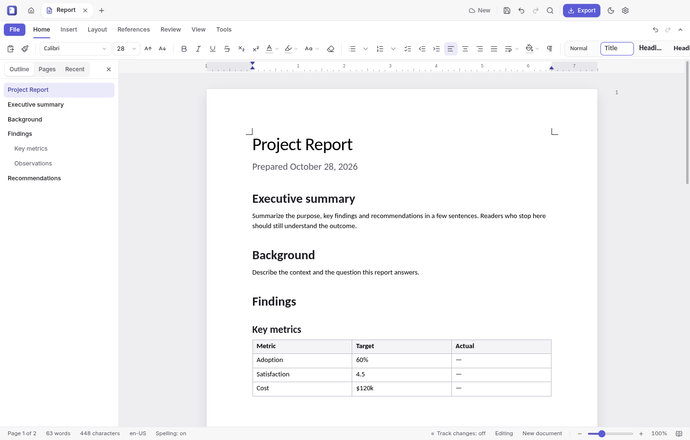
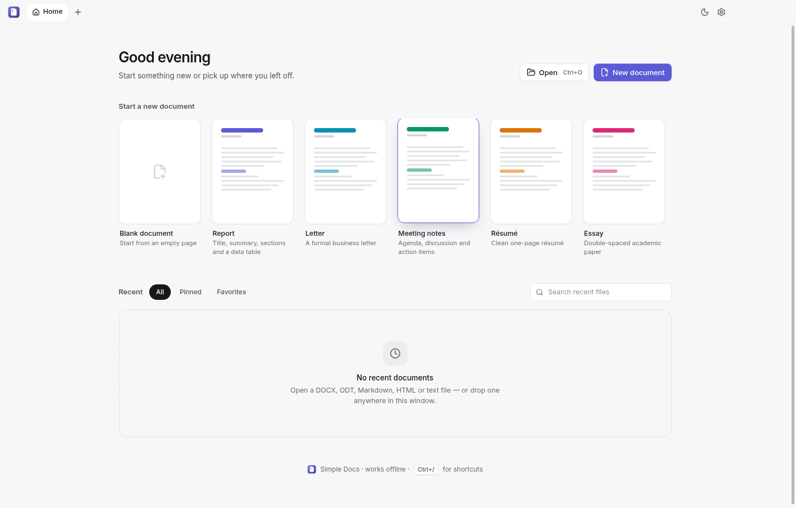
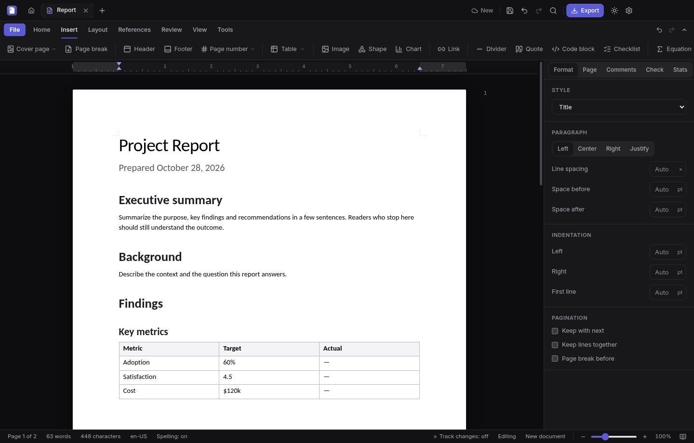
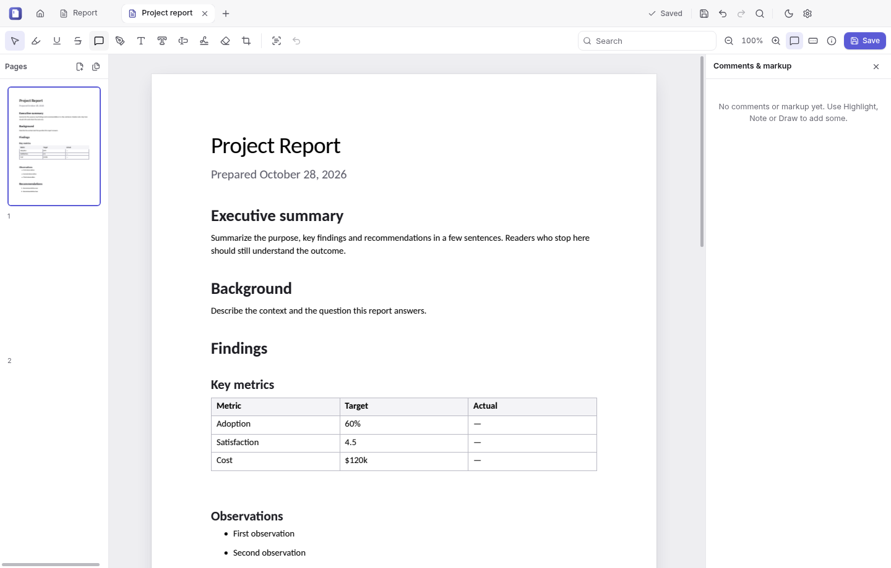

# Simple Docs

A fast, private word processor for Windows, macOS and Linux. Write on real pages, open and save Word (DOCX) and LibreOffice (ODT) files, export PDFs that look exactly like the screen, and edit PDFs too. It works offline, with no account.

## Download and install

Download the newest version from the **[Releases page](https://github.com/fleetwoodjohnr/simple-docs/releases/latest)**. Under *Assets*, pick the file for your system:

| System | File to download |
|---|---|
| Windows 10 or 11 (64-bit) | `Simple-Docs-Setup-<version>.exe` |
| Mac with Apple silicon (M1 and later) | `Simple-Docs-<version>-arm64.dmg` |
| Mac with an Intel processor | `Simple-Docs-<version>.dmg` |
| Ubuntu, Debian, Linux Mint | `simple-docs_<version>_amd64.deb` |
| Fedora, RHEL, openSUSE | `simple-docs-<version>.x86_64.rpm` |
| Any other 64-bit Linux | `Simple-Docs-<version>.AppImage` |

The other files on the page (`.zip`, `.blockmap`, `.yml`) are for automatic updates. You don't need them.

**First launch warnings.** Simple Docs is not code-signed yet, so Windows and macOS warn you the first time you open it.

### Windows

1. Run `Simple-Docs-Setup-<version>.exe`.
2. If you see "Windows protected your PC", click **More info**, then **Run anyway**.
3. Choose whether to install for just you or for everyone, and where. Simple Docs then appears in the Start menu.

### macOS

1. Open the `.dmg` and drag **Simple Docs** into **Applications**.
2. Open it from Applications. macOS says it can't verify the app. Click **Done** (on older macOS: **Cancel**).
3. Go to **System Settings → Privacy & Security**, scroll down to the message about Simple Docs, click **Open Anyway** and confirm. On macOS 14 and earlier you can instead Control-click the app and choose **Open**.

You only do this once. Alternatively, run `xattr -dr com.apple.quarantine "/Applications/Simple Docs.app"` in Terminal.

### Linux

- **deb** (Ubuntu, Debian, Mint): `sudo apt install ./simple-docs_*_amd64.deb`
- **rpm** (Fedora and others): `sudo dnf install ./simple-docs-*.x86_64.rpm`
- **AppImage**: make it executable (`chmod +x Simple-Docs-*.AppImage`), then double-click it or run it from a terminal. If it doesn't start, your system may lack FUSE 2. Install `libfuse2` (`libfuse2t64` on Ubuntu 24.04 and later), or run the file with `--appimage-extract-and-run`.

The deb and rpm add Simple Docs to your applications menu and register it for `.docx`, `.odt`, `.md`, `.rtf`, `.txt` and `.pdf` files.

### Updates

Simple Docs checks once a day whether a new version is out. If one is, it asks before downloading anything. Click **Install**, then **Restart**.

- On Linux, a deb or rpm update asks for your password.
- On macOS, the download page opens instead, because unsigned apps can't update themselves. Install the new `.dmg` the same way as the first one.
- **Settings → Updates** turns the daily check off. *Check now* works at any time.

Coming from 0.1.0? That version has no updater, so install 0.2.0 by hand once.

### Uninstall

- **Windows:** Settings → Apps → Simple Docs → Uninstall.
- **macOS:** drag Simple Docs from Applications to the Trash.
- **Linux:** `sudo apt remove simple-docs` or `sudo dnf remove simple-docs`. For the AppImage, delete the file.

Your settings and recovery data stay in your user profile's app-data folder. Delete that folder too for a clean removal.

## Using Simple Docs

### Getting started

- **Start screen.** Create a blank document, start from a template, or reopen a recent file.
- **Opening files.** Press <kbd>Ctrl</kbd>+<kbd>O</kbd>, drag a file onto the window, or double-click a file in your file manager. Several documents open as tabs.
- **The ribbon.** Commands are grouped on tabs, like in Word. **File** has save, export, print and version history; the other tabs:

  | Tab | What's on it |
  |---|---|
  | **Home** | Fonts, paragraph formatting, styles, lists, find and replace |
  | **Insert** | Tables, images, charts and shapes, equations, links, page breaks, headers and footers, cover pages |
  | **Layout** | Page size, orientation, margins, indents and spacing |
  | **References** | Table of contents, footnotes and endnotes, citations and bibliography (APA, MLA, Chicago) |
  | **Review** | Word count, read aloud, accessibility checker, comments, track changes, compare documents, restrict editing |
  | **View** | Zoom, formatting marks, focus mode, ruler, Markdown source |
  | **Tools** | Mail merge, AI assistant, keyboard shortcuts, settings |

- **Dark mode** follows your system, or switch it with the moon icon at the top right.

  

- **Spelling** is checked as you type, offline, in US or UK English (**Settings → Editor**).
- **Keyboard shortcuts.** They are the familiar ones: <kbd>Ctrl</kbd>+<kbd>B</kbd> for bold, <kbd>Ctrl</kbd>+<kbd>Z</kbd> to undo, and so on. On a Mac, use <kbd>⌘</kbd> instead of <kbd>Ctrl</kbd>. Press <kbd>Ctrl</kbd>+<kbd>/</kbd> to see them all; you can change them in **Settings → Editor**.

### Saving, exporting and printing

- **Save** with <kbd>Ctrl</kbd>+<kbd>S</kbd>. A document saves in the format it was opened in. New documents save as DOCX, unless you choose another format with **Save as** (<kbd>Ctrl</kbd>+<kbd>Shift</kbd>+<kbd>S</kbd>) or in **Settings → New documents**.
- **AutoSave.** Once a document has been saved, it is saved again automatically 30 seconds after your last edit. You can change or turn this off in **Settings → Saving & recovery**.
- **Crash recovery.** Unsaved work is kept every few seconds. If the app or your computer crashes, Simple Docs offers your work back the next time it starts.
- **Version history.** Saved versions are kept on this computer, up to 100 per file. Restore, open or compare one from **File → Version history**.
- **PDF and printing.** Export a PDF with <kbd>Ctrl</kbd>+<kbd>Shift</kbd>+<kbd>E</kbd>, or print with <kbd>Ctrl</kbd>+<kbd>P</kbd>. Pages come out exactly as you see them on screen.

### File formats

| Format | Open | Save | Notes |
|---|---|---|---|
| Word (`.docx`) | ✅ | ✅ | Content that Simple Docs can't edit yet is kept and written back unchanged |
| OpenDocument (`.odt`) | ✅ | ✅ | |
| Markdown (`.md`) | ✅ | ✅ | Edit visually, or as source (View → Markdown source) |
| HTML, plain text | ✅ | ✅ | |
| Rich Text (`.rtf`) | ✅ | ✅ | Needs [LibreOffice](https://www.libreoffice.org) installed |
| Old Word (`.doc`) | ✅ | — | Needs LibreOffice; save as DOCX |
| PDF | ✅ | ✅ | Opens in the PDF editor (below); any document can be exported as PDF |

If a file contains something a format can't hold, Simple Docs tells you what will change before it saves. For element-by-element details, see [COMPATIBILITY.md](COMPATIBILITY.md).

### Editing PDFs

Opening a PDF switches to the PDF editor:

There you can:
- highlight, underline, strike out, add notes and draw
- change existing text, add new text and sign
- permanently remove (redact) text and images
- fill in and create form fields
- reorder, rotate, crop, insert and delete pages; merge PDFs, split one, or extract a page
- make scanned pages searchable with offline text recognition (OCR, English)
- open password-protected files

### Mail merge

1. On **Tools**, choose **Recipients…** and pick a CSV file with one row per recipient.
2. Place fields in your letter with **Insert field**.
3. Use **Preview** to step through the recipients.
4. **Finish & merge** creates one document with a copy per recipient.

The recipient list is saved with the document.

### AI assistant (optional)

The assistant can rewrite, proofread, shorten or summarize selected text, using Anthropic's Claude.
- It is **off** by default. Turn it on in **Settings → AI assistant** and paste your own [Anthropic API key](https://console.anthropic.com).
- Nothing is sent automatically. Each request shows exactly what will be sent, and goes out only when you click **Send**.

### Privacy

No account and no telemetry. Simple Docs only uses the network for:
- **The daily update check**, which asks GitHub whether there is a new version. It sends none of your documents and can be turned off in **Settings → Updates**.
- **The AI assistant**, when you turn it on and click **Send**.

Links you click open in your web browser.

## Help and feedback

Found a bug or missing a feature? [Open an issue](https://github.com/fleetwoodjohnr/simple-docs/issues). Please attach a sample file if you can.

- What changed in each version: [CHANGELOG.md](CHANGELOG.md)
- What works today and what is planned: [IMPLEMENTATION_STATUS.md](IMPLEMENTATION_STATUS.md)

## Building from source

See [DEVELOPMENT.md](DEVELOPMENT.md) for building, testing, the architecture and third-party licenses. [RELEASE.md](RELEASE.md) describes how releases are made.

Simple Docs is released under the MIT license.
